

<picture>
  <source media="(prefers-color-scheme: dark)" srcset="assets/hero-dark.svg">
  <source media="(prefers-color-scheme: light)" srcset="assets/hero-light.svg">
  
</picture>

Low-level programming, from allocators and filesystems to emulators and a software renderer.
Everything on this page is generated from my own GitHub data by workflows in this repository, with no third-party image service.
Private work is counted in the totals but never named.

<picture>
  <source media="(prefers-color-scheme: dark)" srcset="assets/terminal-dark.svg">
  <source media="(prefers-color-scheme: light)" srcset="assets/terminal-light.svg">
  
</picture>

## Stack

<picture>
  <source media="(prefers-color-scheme: dark)" srcset="assets/languages-dark.svg">
  <source media="(prefers-color-scheme: light)" srcset="assets/languages-light.svg">
  
</picture>

## Selected work

### Systems

<table>
<tr><td width="50%"><a href="https://github.com/AurelienBaraquin/nlc"><picture><source media="(prefers-color-scheme: dark)" srcset="assets/cards/nlc-dark.svg"><source media="(prefers-color-scheme: light)" srcset="assets/cards/nlc-light.svg"></picture></a></td><td width="50%"><a href="https://github.com/AurelienBaraquin/CLPF"><picture><source media="(prefers-color-scheme: dark)" srcset="assets/cards/CLPF-dark.svg"><source media="(prefers-color-scheme: light)" srcset="assets/cards/CLPF-light.svg"></picture></a></td></tr>
<tr><td width="50%"><a href="https://github.com/AurelienBaraquin/malloc_for_myOS"><picture><source media="(prefers-color-scheme: dark)" srcset="assets/cards/malloc_for_myOS-dark.svg"><source media="(prefers-color-scheme: light)" srcset="assets/cards/malloc_for_myOS-light.svg"></picture></a></td><td width="50%"><a href="https://github.com/AurelienBaraquin/CloudFUSEStream"><picture><source media="(prefers-color-scheme: dark)" srcset="assets/cards/CloudFUSEStream-dark.svg"><source media="(prefers-color-scheme: light)" srcset="assets/cards/CloudFUSEStream-light.svg"></picture></a></td></tr>
<tr><td width="50%"><a href="https://github.com/AurelienBaraquin/How-to-write-a-Linux-syscall-in-C"><picture><source media="(prefers-color-scheme: dark)" srcset="assets/cards/How-to-write-a-Linux-syscall-in-C-dark.svg"><source media="(prefers-color-scheme: light)" srcset="assets/cards/How-to-write-a-Linux-syscall-in-C-light.svg"></picture></a></td><td width="50%"></td></tr>
</table>

### Emulation and games

<table>
<tr><td width="50%"><a href="https://github.com/AurelienBaraquin/raycaster"><picture><source media="(prefers-color-scheme: dark)" srcset="assets/cards/raycaster-dark.svg"><source media="(prefers-color-scheme: light)" srcset="assets/cards/raycaster-light.svg"></picture></a></td><td width="50%"><a href="https://github.com/AurelienBaraquin/GameBoy_Emulator"><picture><source media="(prefers-color-scheme: dark)" srcset="assets/cards/GameBoy_Emulator-dark.svg"><source media="(prefers-color-scheme: light)" srcset="assets/cards/GameBoy_Emulator-light.svg"></picture></a></td></tr>
<tr><td width="50%"><a href="https://github.com/AurelienBaraquin/nes_rust_emulator"><picture><source media="(prefers-color-scheme: dark)" srcset="assets/cards/nes_rust_emulator-dark.svg"><source media="(prefers-color-scheme: light)" srcset="assets/cards/nes_rust_emulator-light.svg"></picture></a></td><td width="50%"><a href="https://github.com/AurelienBaraquin/NESCARGOT"><picture><source media="(prefers-color-scheme: dark)" srcset="assets/cards/NESCARGOT-dark.svg"><source media="(prefers-color-scheme: light)" srcset="assets/cards/NESCARGOT-light.svg"></picture></a></td></tr>
</table>

### Tooling and AI

<table>
<tr><td width="50%"><a href="https://github.com/AurelienBaraquin/claude-project-kit"><picture><source media="(prefers-color-scheme: dark)" srcset="assets/cards/claude-project-kit-dark.svg"><source media="(prefers-color-scheme: light)" srcset="assets/cards/claude-project-kit-light.svg"></picture></a></td><td width="50%"><a href="https://github.com/AurelienBaraquin/chinese_notebook"><picture><source media="(prefers-color-scheme: dark)" srcset="assets/cards/chinese_notebook-dark.svg"><source media="(prefers-color-scheme: light)" srcset="assets/cards/chinese_notebook-light.svg"></picture></a></td></tr>
<tr><td width="50%"><a href="https://github.com/AurelienBaraquin/my-infra"><picture><source media="(prefers-color-scheme: dark)" srcset="assets/cards/my-infra-dark.svg"><source media="(prefers-color-scheme: light)" srcset="assets/cards/my-infra-light.svg"></picture></a></td><td width="50%"></td></tr>
</table>

### Web

<table>
<tr><td width="50%"><a href="https://github.com/AurelienBaraquin/portfolio"><picture><source media="(prefers-color-scheme: dark)" srcset="assets/cards/portfolio-dark.svg"><source media="(prefers-color-scheme: light)" srcset="assets/cards/portfolio-light.svg"></picture></a></td><td width="50%"><a href="https://github.com/AurelienBaraquin/miku-teto-ui"><picture><source media="(prefers-color-scheme: dark)" srcset="assets/cards/miku-teto-ui-dark.svg"><source media="(prefers-color-scheme: light)" srcset="assets/cards/miku-teto-ui-light.svg"></picture></a></td></tr>
</table>

## Activity

<picture>
  <source media="(prefers-color-scheme: dark)" srcset="assets/activity-dark.svg">
  <source media="(prefers-color-scheme: light)" srcset="assets/activity-light.svg">
  
</picture>

## Walk the corridor

This frame is rendered by the engine of my [raycaster](https://github.com/AurelienBaraquin/raycaster), and every visitor shares the same camera.
Pick a direction: it opens a pre-filled issue, a workflow moves the camera with the engine's own collision and doors, then closes the issue.
Each visitor can take one step every 20 seconds and reset once an hour.
Expect a minute or two, and a few more for GitHub to refresh the cached image.

<table>
<tr>
<td align="center" valign="top" width="60%">

 
<a href="https://github.com/AurelienBaraquin/AurelienBaraquin/issues/new?title=walk%3Aleft&body=Just%20press%20Submit%20new%20issue.%20A%20bot%20moves%20the%20camera%20and%20closes%20this%20issue.">turn left</a> ·
<a href="https://github.com/AurelienBaraquin/AurelienBaraquin/issues/new?title=walk%3Aforward&body=Just%20press%20Submit%20new%20issue.%20A%20bot%20moves%20the%20camera%20and%20closes%20this%20issue.">forward</a> ·
<a href="https://github.com/AurelienBaraquin/AurelienBaraquin/issues/new?title=walk%3Aright&body=Just%20press%20Submit%20new%20issue.%20A%20bot%20moves%20the%20camera%20and%20closes%20this%20issue.">turn right</a>
 
<a href="https://github.com/AurelienBaraquin/AurelienBaraquin/issues/new?title=walk%3Aback&body=Just%20press%20Submit%20new%20issue.%20A%20bot%20moves%20the%20camera%20and%20closes%20this%20issue.">back</a> ·
<a href="https://github.com/AurelienBaraquin/AurelienBaraquin/issues/new?title=walk%3Areset&body=Just%20press%20Submit%20new%20issue.%20A%20bot%20moves%20the%20camera%20and%20closes%20this%20issue.">reset</a></td>
<td align="center" valign="top" width="40%">
<picture><source media="(prefers-color-scheme: dark)" srcset="https://raw.githubusercontent.com/AurelienBaraquin/AurelienBaraquin/game-state/leaderboard-dark.svg"><source media="(prefers-color-scheme: light)" srcset="https://raw.githubusercontent.com/AurelienBaraquin/AurelienBaraquin/game-state/leaderboard-light.svg"></picture>
</td>
</tr>
</table>

## Status

<picture>
  <source media="(prefers-color-scheme: dark)" srcset="assets/status-dark.svg">
  <source media="(prefers-color-scheme: light)" srcset="assets/status-light.svg">
  
</picture>

Built with TypeScript, SVG and GitHub Actions. Source and workflows are in this repository. Portfolio: <a href="https://aurelienb.com">aurelienb.com</a>.
